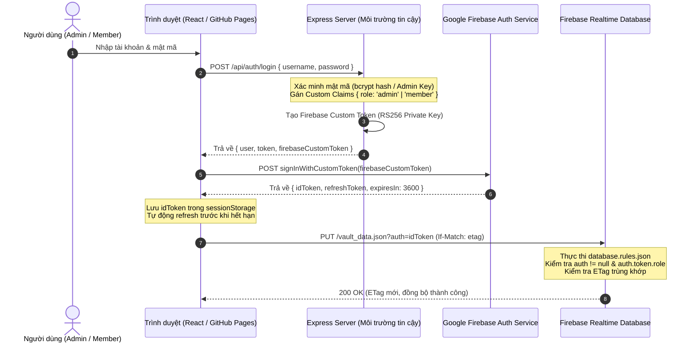

# HƯỚNG DẪN CẤU HÌNH FIREBASE CONSOLE & TRIỂN KHAI PRODUCTION
**Dự án**: Digital Secret Letter  
**Phiên bản**: Release Candidate 1.0.0-rc1.1  
**Mục đích**: Hướng dẫn chủ sở hữu dự án thiết lập Firebase Authentication, Service Account và triển khai Security Rules an toàn.

---

## 1. TỔNG QUAN LUỒNG FIREBASE AUTHENTICATION (ARCHITECTURE FLOW)



---

## 2. CÁC BƯỚC CẤU HÌNH TRÊN FIREBASE CONSOLE

### Bước 1: Kích hoạt Firebase Authentication
1. Truy cập [Firebase Console](https://console.firebase.google.com/) và chọn dự án `secretletter` (hoặc tạo dự án mới).
2. Vào menu **Build** $\rightarrow$ **Authentication** $\rightarrow$ Chọn **Get started**.
3. Tại tab **Sign-in method**:
   - Bật **Email/Password** (cho phép người dùng đăng nhập tài khoản).
   - Bật **Anonymous** (nếu muốn người nhận thư vãng lai chỉ đọc được thư công khai/mở khóa bằng passcode).

### Bước 2: Tạo Service Account Private Key cho Backend
> [!IMPORTANT]
> Khóa bí mật Service Account Private Key tuyệt đối **CHỈ** được lưu trên môi trường máy chủ (Server Backend). **KHÔNG BAO GIỜ** đưa vào frontend, client bundle, hoặc commit lên Git repository.

1. Tại Firebase Console, nhấn vào biểu tượng **Bánh răng (Project Settings)** $\rightarrow$ Chọn tab **Service accounts**.
2. Chọn **Firebase Admin SDK** $\rightarrow$ Nhấn **Generate new private key** $\rightarrow$ Tải file JSON về máy tính cá nhân.
3. Mở file JSON tải về:
   - Copy giá trị `client_email` đưa vào biến môi trường: `FIREBASE_CLIENT_EMAIL` trong `.env` trên máy chủ.
   - Copy giá trị `private_key` đưa vào biến môi trường: `FIREBASE_PRIVATE_KEY` trong `.env` trên máy chủ.
   - Thêm đường dẫn file JSON vào `.gitignore` (đã được cấu hình tự động).

### Bước 3: Triển khai Firebase Security Rules lên Realtime Database
> [!WARNING]
> Không sửa rules trực tiếp trên production bằng tay mà không qua kiểm thử. File quy tắc chuẩn đã được kiểm chứng 100% trong `database.rules.json`.

1. Cài đặt Firebase CLI (nếu chưa cài):
   ```bash
   npm install -g firebase-tools
   ```
2. Đăng nhập tài khoản Google quản trị:
   ```bash
   firebase login
   ```
3. Liên kết dự án:
   ```bash
   firebase use <your-firebase-project-id>
   ```
4. Kiểm tra cấu hình rules trước khi đẩy:
   File `firebase.json` đã liên kết sẵn:
   ```json
   {
     "database": {
       "rules": "database.rules.json"
     }
   }
   ```
5. Triển khai Security Rules lên Production (chỉ thực hiện sau khi bạn đã duyệt GO):
   ```bash
   firebase deploy --only database:rules
   ```

---

## 3. CHECKLIST KIỂM THỬ SAU TRIỂN KHAI PRODUCTION
- [ ] Mở trình duyệt ẩn danh, truy cập URL RTDB: `https://<project-id>-default-rtdb.firebaseio.com/vault_data.json` $\rightarrow$ Trình duyệt phải báo lỗi `{"error": "Permission denied"}` (Deny-by-default).
- [ ] Đăng nhập tài khoản Member $\rightarrow$ Tạo thư mới $\rightarrow$ Kiểm tra REST request có mang tham số `?auth=<firebase_id_token>`.
- [ ] Đăng nhập tài khoản Admin $\rightarrow$ Vào Creator Studio $\rightarrow$ Xác nhận xem được toàn bộ thư và quản lý thành viên bình thường.
- [ ] Chờ 55 phút để kiểm tra cơ chế tự động làm mới token (Refresh Token) hoạt động mượt mà không làm văng người dùng.
